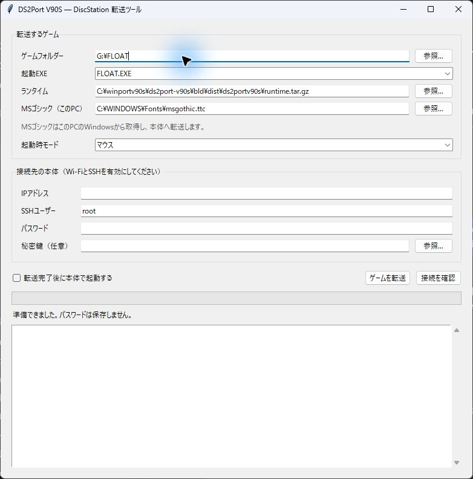
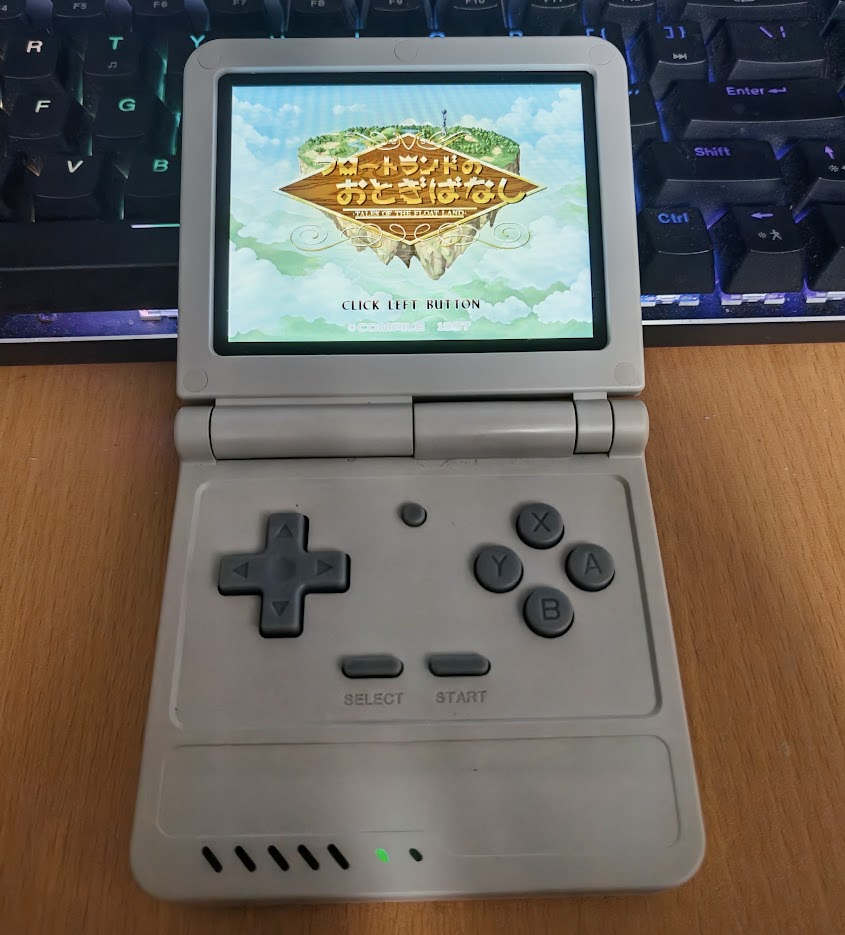

# DS2Port V90S

所有する **Compile DiscStationのWindowsゲームを、PlumOS V90S V2で遊ぶためのWindows用転送ツール**です。PCでゲームのフォルダーを選び、本体へ転送するとPortsから起動できます。

**[Windows版をダウンロード（プレリリース）](https://github.com/mk-822/ds2port-v90s/releases)**

| PCの転送ツール | V90Sでの動作例（FLOAT） |
| --- | --- |
|  |  |

## 機能

- ゲームのフォルダーとEXEを選んで転送。タイトルの事前登録は不要です。
- 日本語表示のずれを補正し、FM音源でのBGM再生と効果音に対応します。
- 本体のボタンでマウス・4ボタンJoypad・キーボードの操作を切り替えられます。
- 本体の音量ボタンや電源メニューを利用できます。
- USB DACへBGM・効果音を出力でき、ゲーム起動中の接続・取り外しにも対応します。
- 効果音が重なる場面の音声処理を軽くし、音飛びやゲームの引っかかりを減らします。
- ゲームの動作環境を共用し、本体の空き容量と初回準備・再転送の量を節約します。

## 使用方法

必要なもの：Windows x64のPC、PlumOS V90S V2の本体、所有するDiscStationの32bit Windowsゲーム。

1. ダウンロードしたZIPを展開し、`DS2PortV90S.exe` を起動します。ZIP内のファイルはまとめて同じフォルダーに置いてください。
2. 本体のWi-FiとSSHを有効にします。起動中のゲームは終了してください。
3. ツールでゲームのフォルダーと起動EXE、起動時の操作モードを選び、本体のIPアドレスとSSHログイン情報を入力します。EXEが1つなら自動で選ばれます。
4. 「接続を確認」で空き容量を確認し、「ゲームを転送」を押します。初回のみ接続先のSSHホスト鍵を確認して登録します。
5. 本体の **Ports** からゲームを起動します。動作環境の初回準備には数分かかる場合があります。準備済みなら、別のゲームでも同じ環境を使います。

接続先IPとSSHユーザーは終了時にこのPCへ保存し、次回起動時に復元します。パスワードは「SSHパスワードを保存する」にチェックした場合だけ保存します。チェックを外して終了すると、以前保存したパスワードも削除します。

更新するときは、ゲームを終了して新版ツールで同じゲームを再転送してください。PC側の原本は変更せず、本体の既存セーブを保持するように転送します。

## 操作

**L2**でマウス → Joypad → キーボードの順に切り替えます。起動時のモードは転送ツールで指定できます。

| 操作 | マウスモード | Joypadモード | キーボードモード |
| --- | --- | --- | --- |
| 十字キー | カーソル移動 | 方向入力 | 矢印キー |
| B | 左クリック | ボタン2 | Xキー |
| A | 右クリック | ボタン3 | Cキー |
| Y | 押している間カーソル2倍速 | ボタン1 | Zキー |
| X | 割り当てなし | ボタン4 | Escキー |
| R2 | 押している間カーソル2倍速 | 割り当てなし | 割り当てなし |

全モード共通で **START＝Enter、SELECT＝Escape、START＋SELECT＝ゲーム終了**。L1/R1は割り当てなしです。モードを切り替えたときは左上に約2秒間表示します。

## 動作確認と補足

JUMP3・FLOAT・OPMON・DF3・GEO3・ANGLER・COMETで表示や操作を確認しています。すべてのタイトルや場面を保証する段階ではないため、プレリリースとして公開しています。[詳しい検証記録](docs/VALIDATION.md)

ゲーム本体とMSゴシックは配布物に含みません。ゲームは利用者が用意し、MSゴシックは転送ツールを実行するPCから取得します。本体にはゲーム用と動作環境用の空き容量が必要です。

- [配置・更新・バックアップとビルド手順](docs/SETUP.md)
- [開発構成](docs/DEVELOPMENT.md) / [性能測定](docs/PERFORMANCE.md)
- [ライセンス（GPL-3.0-or-later）](LICENSE) / [依存物のライセンス](THIRD_PARTY.md)

実機写真は利用者提供です。ゲーム画面の権利は各権利者に帰属します。
